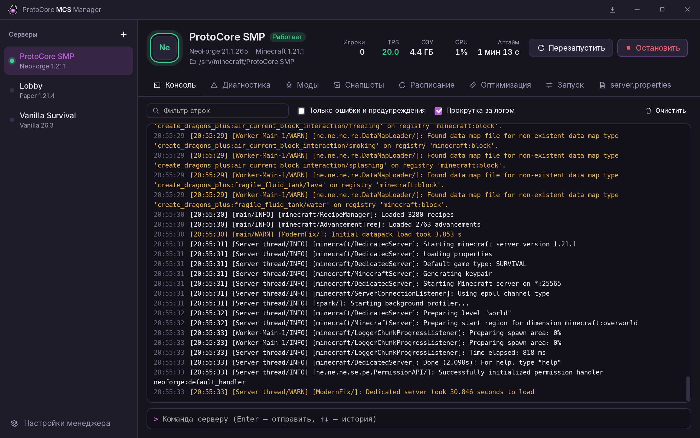
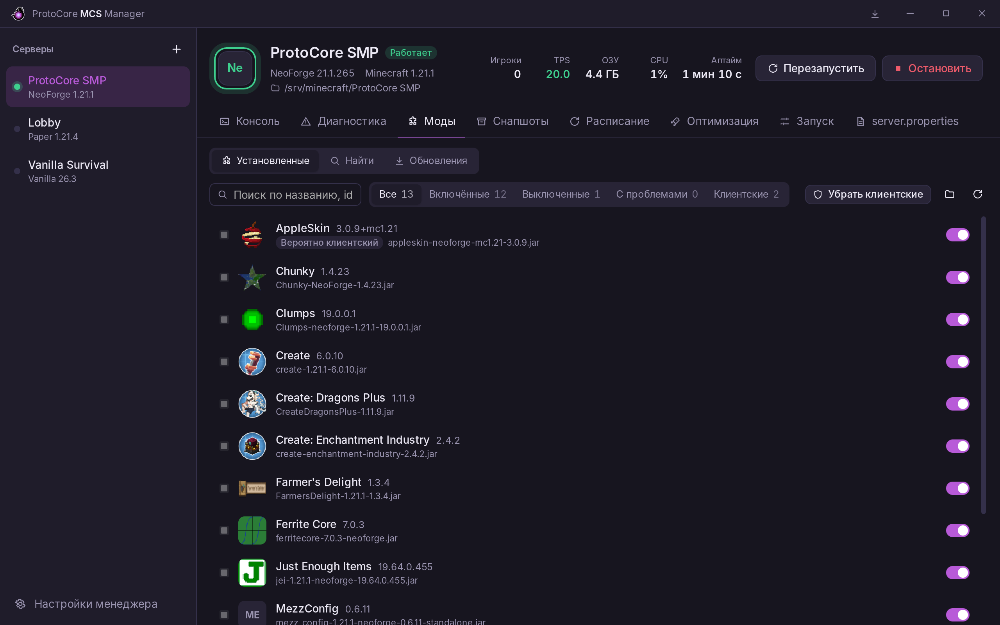
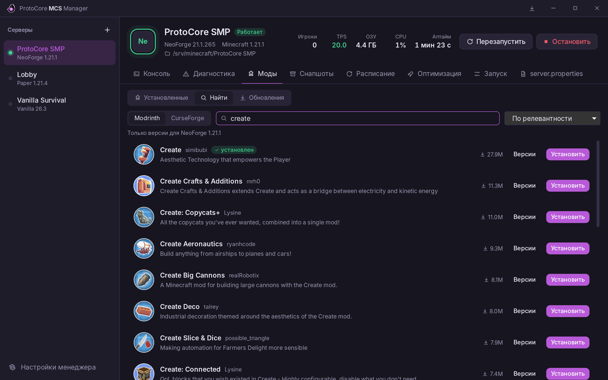
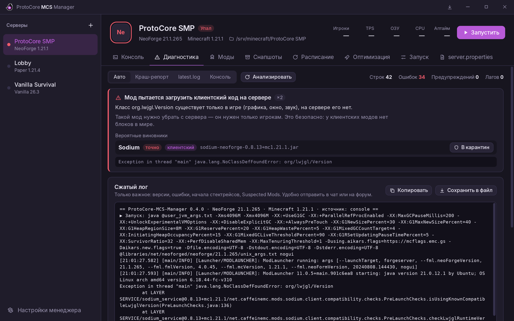
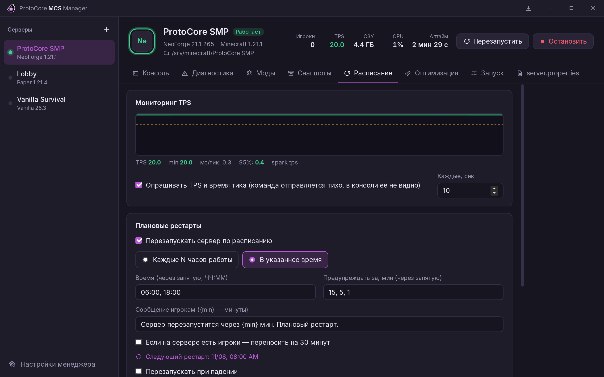
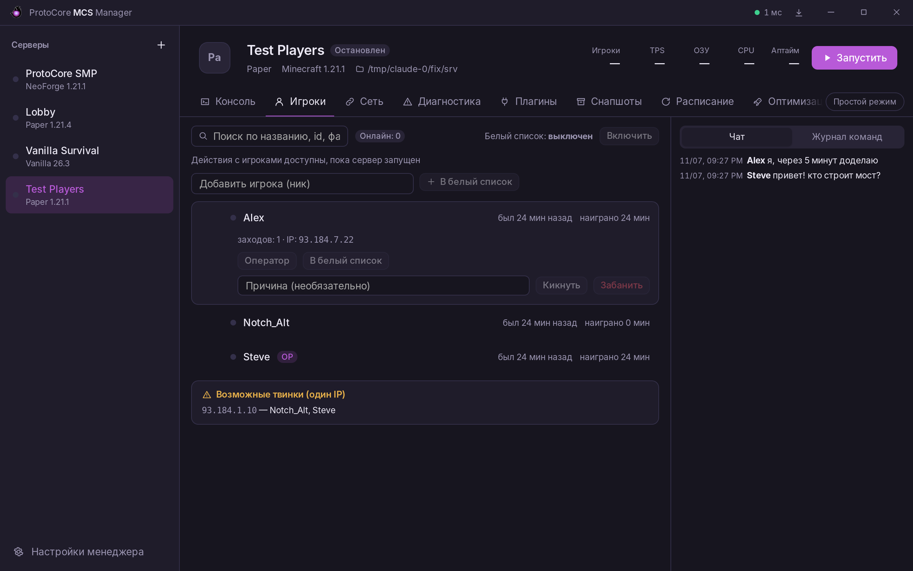
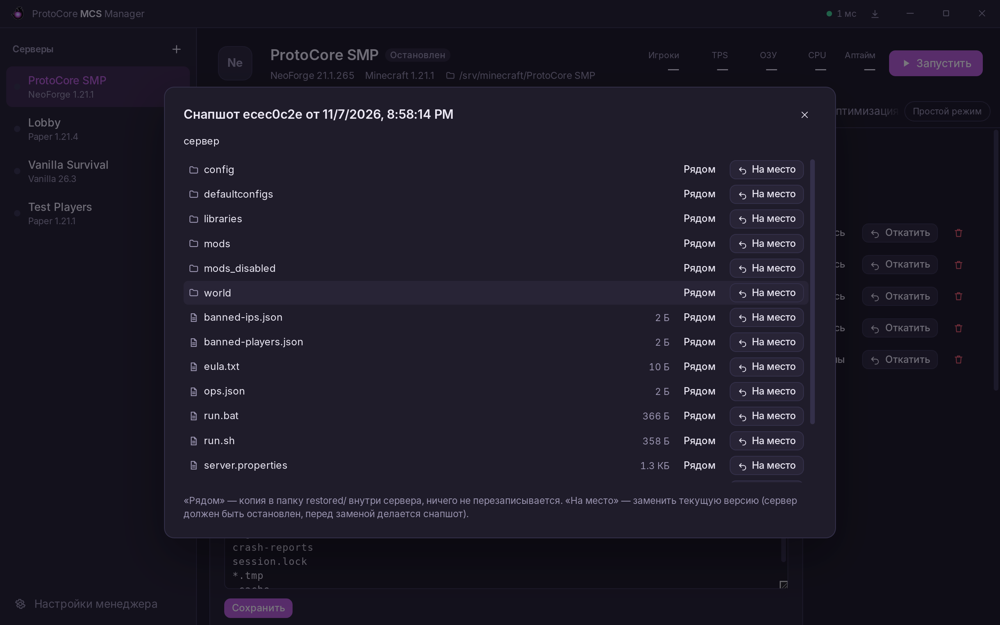
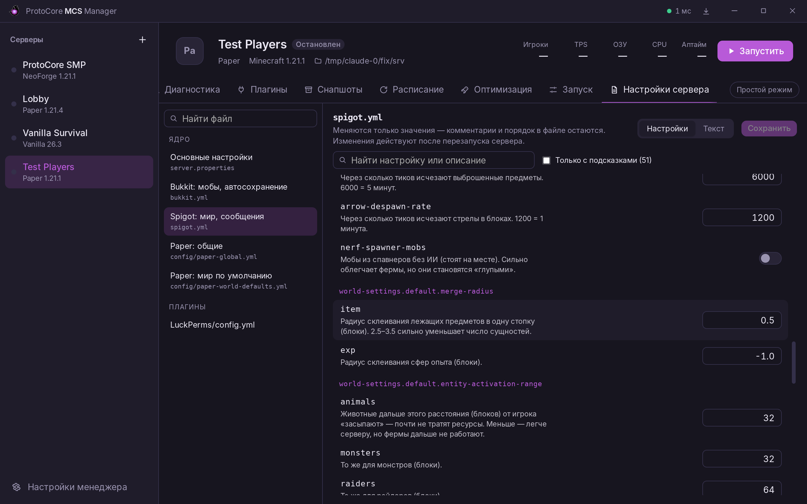

<p align="center">
  <picture>
    <source media="(prefers-color-scheme: dark)" srcset="docs/logo-outlined.png">
    
  </picture>
</p>

<h1 align="center">ProtoCore-MCS-Manager</h1>

<p align="center">
  A Minecraft server manager for Windows: launching, console, mods and plugins,<br>
  crash diagnostics, snapshots with rollback, players, notifications and a Telegram bot.<br>
  Lightweight: Rust core, the UI is unloaded from memory while the window sits in the tray.
</p>

<p align="center">
  <a href="https://github.com/enigmatic-a-huli-net/ProtoCore-MCS-Manager/releases/latest"><b>Download the latest version</b></a> · <a href="README.md">Русский</a>
</p>



<table>
  <tr>
    <td></td>
    <td></td>
  </tr>
  <tr>
    <td align="center">Mods: icons, dependencies, client-only mods</td>
    <td align="center">Catalog: Modrinth, Hangar, CurseForge</td>
  </tr>
  <tr>
    <td></td>
    <td></td>
  </tr>
  <tr>
    <td align="center">Diagnostics: the crash culprit and a compact log</td>
    <td align="center">Schedule: TPS, restarts, nightly backups</td>
  </tr>
  <tr>
    <td></td>
    <td></td>
  </tr>
  <tr>
    <td align="center">Players: history, alts, chat</td>
    <td align="center">Snapshots: restore a single file or folder</td>
  </tr>
  <tr>
    <td></td>
    <td></td>
  </tr>
  <tr>
    <td align="center">Core and mod settings with hints</td>
    <td></td>
  </tr>
</table>

The interface is available in Russian and English (Settings → Language). Screenshots show the Russian UI.

## Features

### Servers and launching
- **Servers** — point it at a folder; core and version are detected automatically (Vanilla, Paper,
  Purpur, Folia, Spigot, Fabric, Quilt, Forge, NeoForge, hybrids Youer / Mohist / Arclight).
- **New server** wizard: core, version, build, folder; Forge/NeoForge via the official installer.
  Or **from a modpack** (`.mrpack` / CurseForge). **Core updates** with a snapshot first.
- **Launch** — the command is built from settings (RAM, Aikar or ZGC flags) or your own `.bat` is run.
- **Java** — finds installed versions, picks the right one for the Minecraft version and can
  download Eclipse Temurin in one click.
- **Pre-start check** — busy port, a world opened by another process, wrong Java, low disk space —
  caught before launch and explained in plain words.
- **Console** — live log with highlighting, filter, command history; TPS/MSPT, players, RAM, CPU, uptime.
- **Server config** — `server.properties`, `bukkit.yml`, `spigot.yml`, `paper-*.yml`, `purpur.yml`, mod (`*.toml`)
  and plugin configs in one place: toggles, search and hints for 150+ core settings. Only values change —
  comments stay; a Text mode with syntax checking for everything else.
- **Auto-restart** on crash with crash-loop protection. **Schedule** — planned restarts with player
  warnings and nightly backups.

### Mods and plugins
- List with icons, enable/disable (moved to `mods_disabled/`, nothing is deleted), dependencies,
  conflicts, automatic removal of client-only mods.
- **Catalog** for Modrinth, Hangar and CurseForge with dependency resolution; update checks.
- **Updates via a test copy** — updates are installed on a copy of the server and moved to the real
  one only if the copy starts.
- **Pack for players** — export a `.mrpack` with the same mods.

### When something breaks
- **Diagnostics** — common errors from crash reports and logs as cards, the guilty mod, a compact log
  to paste into a chat. **Auto-quarantine** disables the mod that crashed the server.
- **Mod bisect** — finds the mod that crashes the server using a test copy (own world and port).
- **Logs** — search all logs including old compressed ones; compress and clean up.
- **Optimization** — advice on memory, Java, settings and mods with “apply” buttons.

### Snapshots (restic)
- Incremental and deduplicated — a snapshot before every start takes almost no space.
  On a running server: `save-off` → `save-all flush` → snapshot → `save-on`.
- **Rollback** in one click (with a safety snapshot of the current state) or **a single file / folder**
  from any snapshot; “what changed” between snapshots.
- **Retention policy** — e.g. 7 daily, 4 weekly and 6 monthly; the rest is pruned automatically.
- **Second storage** (3-2-1 rule): copy to another drive, a NAS or the cloud; weekly data check;
  server change log.

### Players, network, notifications
- **Players** — who is online and for how long, OP / whitelist / kick / ban buttons, possible alts
  by shared IP (IPs can be stored hashed only), chat and command log.
- **Network** — packet loss and latency graph, address for friends, open-port check, UPnP,
  CGNAT detection with a tunnel hint.
- **Notifications** to Telegram and Discord: crash, low TPS, low disk, backup failure.
  Repeats are merged, quiet hours with a morning summary.
- **Telegram bot** — `/status`, `/players`, `/run`, `/stop`, `/restart`, `/backup`, `/say`.
  Only admins can control servers; dangerous commands need a button confirmation.

### Convenience
- **Simple mode** (main tabs only) and “?” hints on tricky settings.
- **Sound alerts** for start, crash, player join and problems — audible even from the tray.
- Dark/light/system theme, custom accent, corner radius, font size. Russian and English.

## Security

- **Signed updates.** Every release is signed with an Ed25519 key in GitHub Actions; the manager
  verifies it with the embedded public key and refuses a tampered file.
- **Encrypted secrets.** Telegram/Discord tokens and the CurseForge key are stored in `config.json`
  encrypted with Windows DPAPI — a copied manager folder can't read them on another PC.
- **The bot** answers only its own chat, only admins can control servers, commands are rate-limited.
- **Nothing is deleted silently**: disabled mods/plugins go to `*_disabled/`, old versions to `*_old/`,
  a snapshot is taken before rollbacks and core updates.

## Install

Download the latest **[release](https://github.com/enigmatic-a-huli-net/ProtoCore-MCS-Manager/releases/latest)**:

- `ProtoCore-MCS-Manager-portable.zip` — unzip and run, everything stays next to the .exe;
- `*-setup.exe` — installer.

Requires WebView2 (already present on Windows 10/11). restic and Java are downloaded by the manager.

## Build from source

Requires [Rust](https://rustup.rs) and [Node.js 22](https://nodejs.org).

```bat
npm install
npx tauri dev      :: development mode
npx tauri build    :: ready .exe in target\release
cargo test -p pcm-core
```

Project layout: `core/` — all logic in Rust without UI, `src-tauri/` — window, tray, commands, bot,
scheduler, `ui/` — Svelte interface. See the [Russian README](README.md) for a file-by-file map.
