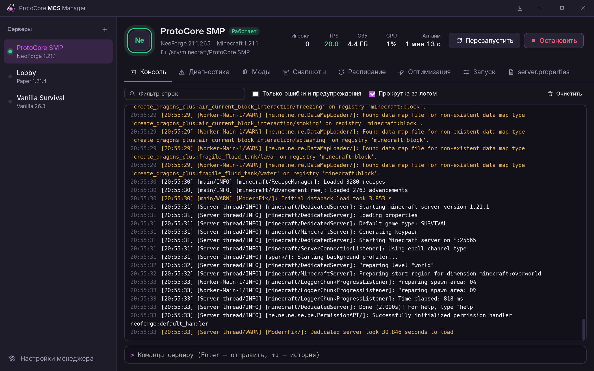
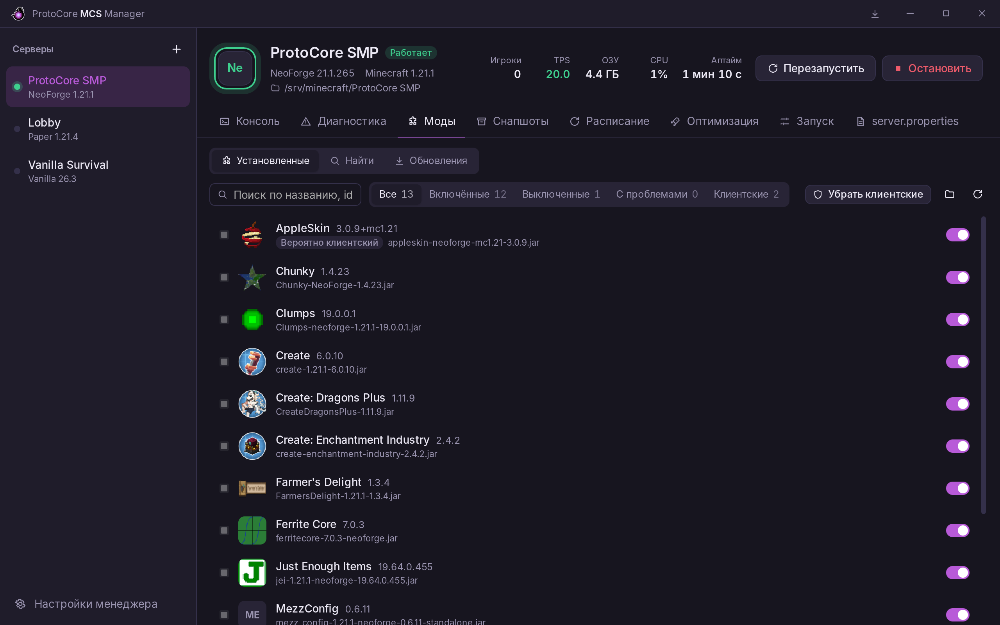
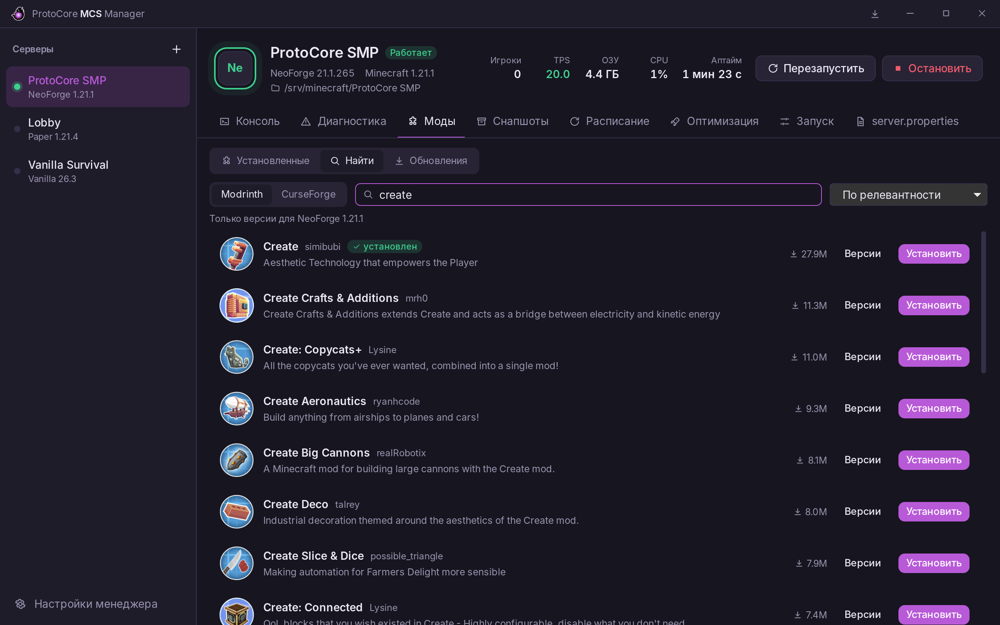
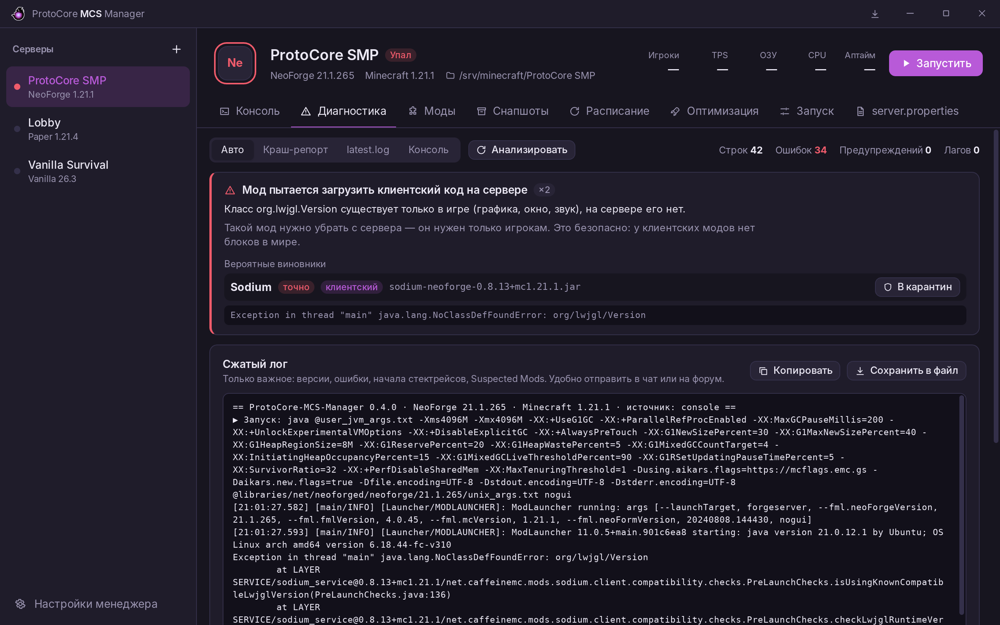
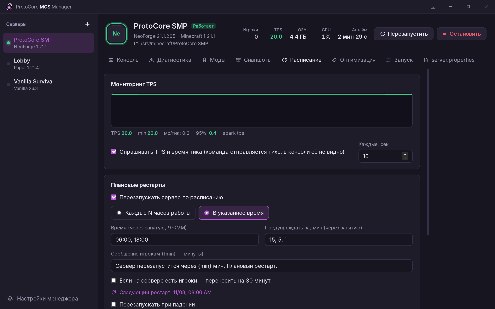
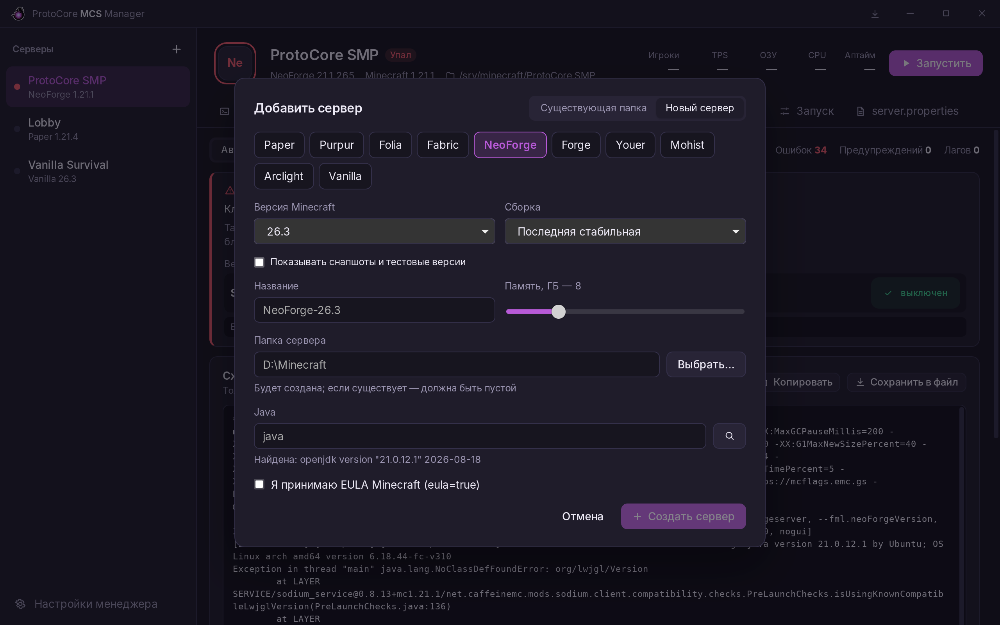
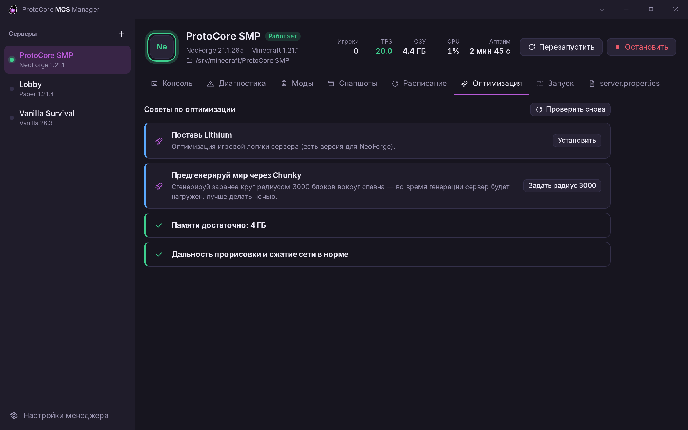
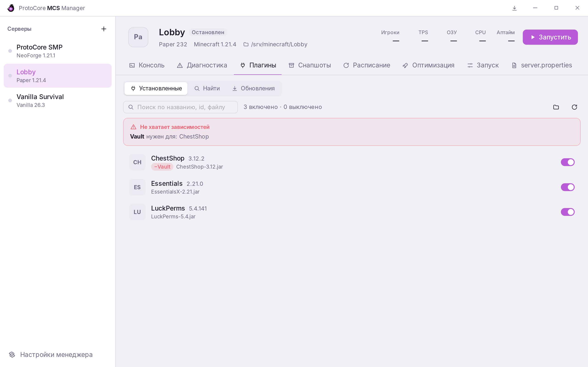

<p align="center">
  <picture>
    <source media="(prefers-color-scheme: dark)" srcset="docs/logo-outlined.png">
    
  </picture>
</p>

<h1 align="center">ProtoCore-MCS-Manager</h1>

<p align="center">
  Менеджер серверов Minecraft для Windows: запуск, консоль, моды и плагины,<br>
  диагностика крашей, снапшоты с откатом одной кнопкой.<br>
  Лёгкий: ядро на Rust, интерфейс выгружается из памяти, когда окно свёрнуто в трей.
</p>

<p align="center">
  <a href="https://github.com/enigmatic-a-huli-net/ProtoCore-MCS-Manager/releases/latest"><b>Скачать последнюю версию</b></a>
</p>



<table>
  <tr>
    <td></td>
    <td></td>
  </tr>
  <tr>
    <td align="center">Моды: иконки, зависимости, клиентские моды</td>
    <td align="center">Каталог: Modrinth, Hangar, CurseForge</td>
  </tr>
  <tr>
    <td></td>
    <td></td>
  </tr>
  <tr>
    <td align="center">Диагностика: виновник краша и сжатый лог</td>
    <td align="center">Расписание: TPS, рестарты, ночные бэкапы</td>
  </tr>
  <tr>
    <td></td>
    <td></td>
  </tr>
  <tr>
    <td align="center">Новый сервер: 10 ядер, любая версия</td>
    <td align="center">Советы по оптимизации с кнопками</td>
  </tr>
  <tr>
    <td></td>
    <td></td>
  </tr>
  <tr>
    <td align="center">Плагины, светлая тема</td>
    <td></td>
  </tr>
</table>

## Что умеет

- **Серверы** — добавляешь папку, ядро и версия определяются сами
  (Vanilla, Paper, Purpur, Folia, Spigot, Fabric, Quilt, Forge, NeoForge,
  гибриды Youer / Mohist / Arclight). Быстрое переключение — клик или `Ctrl+1…9`.
- **Запуск** — команда собирается из настроек (ОЗУ, флаги Aikar или ZGC, Java)
  или запускается твой `.bat`. Итоговая команда видна перед запуском.
- **Консоль** — живой лог с подсветкой WARN/ERROR, фильтр, история команд.
  Статус, игроки, ОЗУ, CPU и аптайм.
- **Моды** — список с иконками, включение/выключение (перенос в `mods_disabled/`,
  ничего не удаляется), зависимости, отсутствующие зависимости, конфликты
  (точные и возможные), отсев клиентских модов.
- **Плагины** — то же для `plugins/` (`plugins_disabled/`), зависимости из plugin.yml.
- **Снапшоты** — через restic: инкрементальные и с дедупликацией, при каждом
  запуске почти не занимают места. На запущенном сервере — `save-off` →
  `save-all flush` → снапшот → `save-on`. Откат: остановка → снапшот текущего
  состояния → восстановление → запуск.
- **Автоперезапуск** при падении с защитой от краш-петли.
- **server.properties** — редактор и рекомендуемые значения для нестабильного канала.
- **Внешний вид** — тёмная/светлая/системная тема, свой акцент и цвета,
  скругление, размер шрифта. Русский и английский.

- **Диагностика** — типичные ошибки из краш-репорта/лога отдельными карточками,
  виновный мод, «сжатый лог» для отправки в чат.
- **Автокарантин** — мод, уронивший сервер, уходит в `mods_disabled/`, сервер стартует снова.
- **Обновление менеджера** с GitHub по кнопке.
- **Каталог** — поиск и установка модов и плагинов с Modrinth, Hangar и CurseForge
  (с ключом) с автоподбором зависимостей; проверка обновлений; «скачать подходящую версию».
- **Новый сервер** — мастер: ядро, версия, сборка, папка; Forge/NeoForge через официальный
  установщик. **Обновление ядра** со снапшотом.
- **TPS/MSPT** в шапке и график; опрос тихий, консоль не засоряется.
- **Расписание** — плановые рестарты с предупреждением игрокам и ночные бэкапы.
- **Автоперебор модов** — находит мод, роняющий сервер, на тестовой копии (свой мир и порт).
- **Оптимизация** — советы по памяти, Java, настройкам и полезным модам с кнопками «применить».
- **Проверка перед запуском** — занятый порт, мир, открытый другим процессом, неподходящая Java,
  мало места на диске — ловится до запуска и объясняется по-человечески.
- **Java** — менеджер сам находит установленные версии, подбирает нужную под версию Minecraft
  и может скачать Eclipse Temurin в один клик.
- **Игроки** — кто онлайн и сколько играл, OP / белый список / кик / бан кнопками,
  возможные твинки по общему IP, чат и журнал команд.
- **Уведомления** в Telegram и Discord (падение, низкий TPS, мало места, сбой бэкапа)
  и Telegram-бот: `/status`, `/restart`, `/backup` с телефона.
- **Сеть** — график потерь и задержки интернета, адрес для друзей, проверка открытого порта,
  открытие порта через UPnP, распознавание «серого» IP (CGNAT) с подсказкой про туннель.
- **Сборки** — создание сервера из `.mrpack` / CurseForge-сборки и экспорт клиентской
  сборки для игроков.
- **Снапшоты, продвинутое** — просмотр файлов снапшота и восстановление одного файла или папки,
  «что изменилось» между снапшотами, копия во второе хранилище (диск, NAS, облако — правило 3-2-1),
  еженедельная проверка данных, журнал изменений сервера.
- **Обновления модов через тестовую копию** — обновления ставятся на копию сервера,
  и только если она запустилась, переносятся в настоящий.
- **Логи** — поиск по всем логам, включая старые сжатые, сжатие и чистка.
- **Простой режим** и подсказки «?» для тех, кто запускает сервер впервые.

## Установка

Скачай последнюю сборку во вкладке **Actions** (артефакт `ProtoCore-MCS-Manager-windows`)
или в **Releases**:

- `ProtoCore-MCS-Manager-portable.zip` — распаковать и запустить, всё хранится рядом с .exe;
- `*-setup.exe` — установщик.

Нужен WebView2 (в Windows 10/11 уже есть). restic менеджер скачает сам
на вкладке «Снапшоты».

## Обновления

Кнопка со стрелкой справа сверху проверяет последний релиз на GitHub, скачивает его
и перезапускает менеджер уже новой версией. Настройки и снапшоты остаются.

Как выпустить новую версию: поменять `version` в `src-tauri/tauri.conf.json`
(и в `Cargo.toml`, `package.json`), описать изменения в `CHANGELOG-latest.md`
и запушить в main — релиз GitHub Actions создаст сам.

## Где что хранится

```
ProtoCore-MCS-Manager.exe
data/config.json      настройки и список серверов
restic/<сервер>/      снапшоты (у каждого сервера своя папка; путь можно сменить)
tools/restic.exe      скачивается автоматически
branding/             свой logo.png и splash.gif (см. branding/README.txt)
```

## Сборка из исходников

Нужны [Rust](https://rustup.rs) и [Node.js 22](https://nodejs.org).

```bat
npm install
npx tauri dev      :: запуск в режиме разработки
npx tauri build    :: готовый .exe в target\release
cargo test -p pcm-core
```

## Устройство проекта

```
core/        вся логика (Rust, без интерфейса) — её проще всего читать и править
  detect.rs    определение ядра и версии
  launch.rs    сборка команды запуска, флаги JVM
  process.rs   процесс сервера, консоль, статус, ОЗУ/CPU
  mods.rs      моды: метаданные, иконки, зависимости, конфликты, клиентские
  plugins.rs   плагины
  backup.rs    restic, снапшоты, откат
  config.rs    настройки
src-tauri/   оболочка: окно, трей, команды для интерфейса
ui/          интерфейс (Svelte)
```

## Идеи на будущее

- веб-панель для отдельного Linux-сервера;
- автообновление модов по расписанию.
